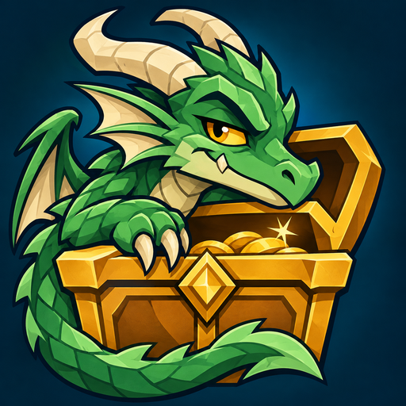
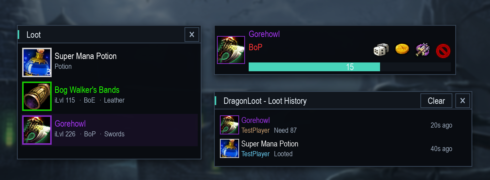
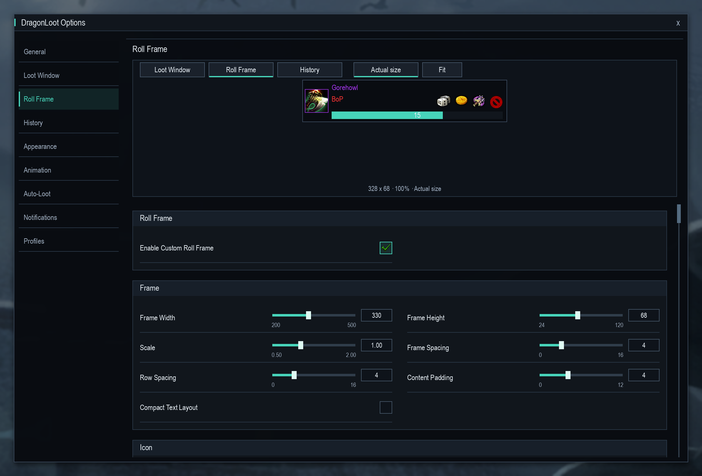

# Dragon Loot

**Roll on the drop. Remember who won.**

[Get it on CurseForge](https://www.curseforge.com/wow/addons/dragon-loot) · [Get it on Wago](https://addons.wago.io/addons/dragon-loot) · [GitHub releases](https://github.com/Xerrion/DragonLoot/releases/latest)

Gorehowl drops. Hover over the axe to compare it with your weapon, hit Need, and follow the tank to the next pack.
Two pulls later, someone asks who got it. Open `/dl history` and there's the winner, right next to their roll.

Dragon Loot replaces WoW's loot window and group rolls and keeps a loot history for each character.

*Offline render of the built-in samples. Follow Gorehowl from the loot window on the left to the roll and its history entry on the right.*

## Before you press Need

Hover the item's icon to compare it with your equipped gear using WoW's comparison key. The timer stays visible while
you decide. You can ask Dragon Loot to confirm Greed and Pass, or have it dismiss each roll as soon as you vote.
On TBC Anniversary and Mists of Pandaria Classic, turn on **Show Roll Tally** to watch the votes come in.
Pair it with **Keep Frame After Voting** to see the winning roll alongside your own if you lose.

## Who won Gorehowl?

Each character’s history survives logout. Open `/dl history` after raid night to see the drops again,
with each winner’s name in their class color. Turn on roll details and click a rolled item to see who chose Need, Greed, or Pass and
what they rolled. You can also record direct pickups and set a minimum quality so a night of farming
doesn't bury the gear you came for.

## On a farming run

Have the loot window open at your cursor. Item level and binding sit underneath the name, and stack counts tell you
how much cloth just dropped. To pick up cloth and rare drops automatically, turn off WoW's built-in Auto Loot, enable **Smart Auto-Loot**,
set **Minimum Quality** to Rare, and add your cloth to the whitelist. The cloth comes with you, and you decide
what to do with the other common drops.

## Make it fit your UI

Narrow the roll frame to fit beside your party frames, or switch on **Compact Text Layout** to put the item name
and its bind type on one line. The sample above the controls updates as you drag the sliders.

*Offline preview of the Roll Frame page in `/dl config`.*

## Get started

1. Install Dragon Loot with your addon manager. For a manual install, put both `DragonLoot` and `DragonLoot_Options` in your client's `Interface/AddOns/` folder and reload the game UI.
2. Type `/dl test` for a sample drop that includes Gorehowl, or `/dl testroll` to try three timed group rolls in town.
3. Open `/dl config` to tune the windows. Save your favorite setup under **Profiles**.

**Supported clients** include Retail, WoW Forever, TBC Anniversary, and Mists of Pandaria Classic.

Dragon Loot works alongside EllesmereUI. If ElvUI handles loot or rolls, Dragon Loot offers to switch off the overlapping modules.

## Pair it with Dragon Toast

Want the winner to pop up while you're moving to the next pull? Dragon Loot can send roll results to Dragon Toast.
[Get Dragon Toast](https://github.com/Xerrion/DragonToast)

More commands and project links

Use `/dl help` for the command list. `/dl reset` centers the loot window, and `/dl testroll loop` keeps sample rolls coming
while you adjust your layout. End the loop with `/dl testroll stop`.

[Settings preview guide](docs/settings-preview.md) · [Report an issue](https://github.com/Xerrion/DragonLoot/issues) · [Contribute code or translations](CONTRIBUTING.md)

Made by [Xerrion](https://github.com/Xerrion). [MIT License](LICENSE). World of Warcraft artwork and icons © Blizzard Entertainment.

